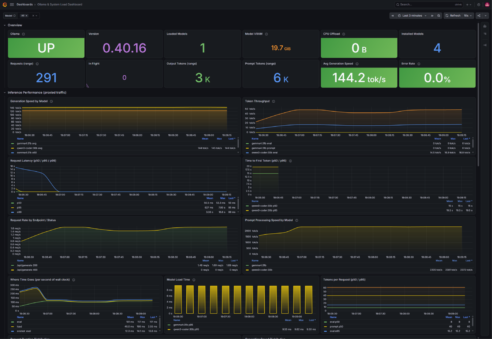
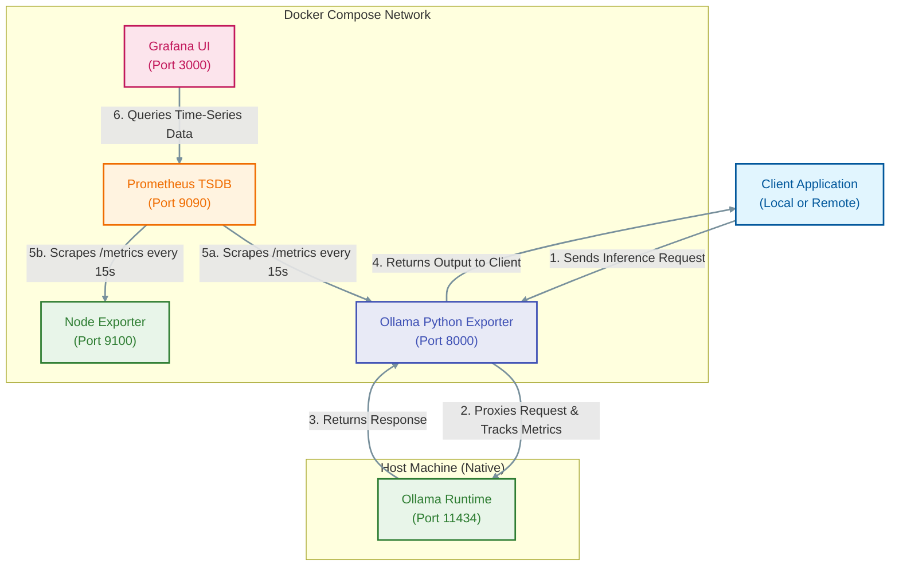

# Ollama Monitoring

A Docker Compose monitoring stack using **Prometheus**, **Grafana**, **Node Exporter**, and a custom **Python FastAPI Proxy/Exporter** to track Ollama inference metrics (token generation, request counts, latency) alongside host system load (CPU, RAM, disk, network).



---

## Architecture

Because Ollama runs natively on your host machine and does not expose native Prometheus metrics, this stack uses a lightweight Python proxy (`ollama-exporter`) to intercept inference requests and expose a `/metrics` endpoint.



---

## Project Structure

```text
ollama-dasbhoard/
├── docker-compose.yml
├── example.env                          # Sample .env for transparent-proxy mode
├── LICENSE
├── README.md
├── prometheus/
│   └── prometheus.yml
├── grafana/
│   ├── provisioning/
│   │   ├── datasources/datasource.yml   # Prometheus datasource (auto-provisioned)
│   │   └── dashboards/dashboard.yml     # Dashboard provider
│   └── dashboards/
│       └── ollama-dashboard.json        # "Ollama & System Load Dashboard"
└── exporter/
    ├── Dockerfile
    ├── README.md                        # Exposed metrics & configuration
    ├── openapi.yaml                     # Upstream Ollama OpenAPI spec (reference)
    └── ollama_exporter.py
```

---

## Prerequisites

* **Docker** and **Docker Compose** installed on your host machine.
* **Ollama** installed on the host machine.

---

## 1. Install & Configure Ollama on the Host

By default, Ollama binds strictly to `127.0.0.1:11434`, which prevents Docker containers from reaching it via `host.docker.internal`. You must configure Ollama to listen on `0.0.0.0`.

### Linux
1. **Install Ollama:**
   ```bash
   curl -fsSL https://ollama.com/install.sh | sh
   ```
2. **Expose Ollama to Docker:**
   Edit the systemd service configuration:
   ```bash
   sudo systemctl edit ollama.service
   ```
   Add the following lines under the `[Service]` section:
   ```ini
   [Service]
   Environment="OLLAMA_HOST=0.0.0.0:11434"
   ```
3. **Reload and Restart Ollama:**
   ```bash
   sudo systemctl daemon-reload
   sudo systemctl restart ollama
   ```
   *(Note: If you use `ufw` or another host firewall, ensure port `11434` is accessible from the Docker bridge subnet, e.g., `sudo ufw allow from 172.17.0.0/16 to any port 11434`.)*

### macOS
1. Download and install Ollama from [ollama.com](https://ollama.com).
2. Set the environment variable via Terminal and restart the app:
   ```bash
   launchctl setenv OLLAMA_HOST "0.0.0.0:11434"
   ```
   Quit Ollama from the menu bar and reopen it.

### Windows
1. Download and install Ollama from [ollama.com](https://ollama.com).
2. Quit Ollama from the system tray.
3. Open **Edit environment variables for your account** in Windows Settings, add a new variable named `OLLAMA_HOST` with the value `0.0.0.0:11434`, and save.
4. Restart Ollama from the Start menu.

### Pull a Model & Verify
Pull a model on your host to test with later:
```bash
ollama pull qwen3.8
```

---

## 2. Run the Monitoring Stack

1. **Clone the repository and navigate into the directory:**
   ```bash
   git clone https://github.com/ahmadi-ali/ollama-dasbhoard.git
   cd ollama-dasbhoard
   ```

2. **Configure `.env` (optional):**
   Docker Compose reads `.env` automatically (see [`example.env`](example.env)). Choose one of the two setups:

   - **Example 1 — Standard mode (default, no `.env` needed):** Ollama stays on `:11434` and the proxy listens on `:8000`:
     ```env
     OLLAMA_UPSTREAM=http://host.docker.internal:11434
     PROXY_PORT=8000
     ```
   - **Example 2 — Transparent mode (capture all `:11434` traffic automatically):** Move host Ollama to `:11435` (`OLLAMA_HOST=0.0.0.0:11435`) and copy `example.env`:
     ```bash
     cp example.env .env
     ```
     ```env
     OLLAMA_UPSTREAM=http://host.docker.internal:11435
     PROXY_PORT=11434
     ```

3. **Build and start the containers:**
   ```bash
   docker compose up -d --build
   ```

4. **Verify all services are running:**
   ```bash
   docker compose ps
   ```

---

## 3. Usage & Routing Requests

To capture Ollama metrics, point your client applications (Open WebUI, LangChain, scripts, or `curl`) to the **exporter proxy on port `8000`** instead of port `11434`:

```bash
curl http://localhost:8000/api/generate -d '{
  "model": "qwen3.8",
  "prompt": "Explain Prometheus in one sentence.",
  "stream": false
}'
```

> [!IMPORTANT]
> Model, VRAM and health metrics are collected by polling Ollama, so they always update. **Request, latency and token metrics only count traffic sent through port `8000`.** Clients that still call `:11434` directly won't show up in those panels. To capture everything without reconfiguring clients, use the transparent mode described in [exporter/README.md](exporter/README.md#capturing-all-traffic).

---

## 4. Access Dashboards & Endpoints

| Service | URL | Credentials / Notes |
| :--- | :--- | :--- |
| **Grafana** | `http://localhost:3000` | No login required (anonymous Admin access enabled; opens dashboard directly) |
| **Prometheus** | `http://localhost:9090` | Check **Status -> Targets** to verify scrapes |
| **Ollama Proxy** | `http://localhost:8000` | Drop-in replacement for Ollama API URL (or `:11434` in transparent mode) |
| **Raw Metrics** | `http://localhost:8000/metrics` | Prometheus metrics exposed by the exporter |

### Setting Up Grafana
Nothing to do: the Prometheus datasource and the **Ollama & System Load Dashboard** are provisioned automatically from `grafana/`, and anonymous login is enabled. Open `http://localhost:3000` in your browser and you land directly on the dashboard. It has four sections:

* **Overview**: Ollama up/version, loaded models, model VRAM, CPU offload, request/token totals, generation speed, error rate.
* **Inference Performance**: tokens/sec per model, token throughput, latency p50/p95/p99, time to first token, request rate by endpoint/status, prompt processing speed, time breakdown (load / prompt / generation), model load time, tokens per request, latency and speed heatmaps.
* **Models**: table of loaded models (params, quant, context, VRAM, CPU offload, keep-alive countdown), memory over time, requests by model, installed models by size.
* **Host System**: CPU, memory, swap, disk, load, uptime, CPU by mode, disk I/O, network, filesystem usage.

Use the **Model** dropdown at the top of the dashboard to show **All** models or one or more specific models. It lists every installed model, every loaded model and every model seen by the proxy. It filters the whole dashboard except the Host System section and the Ollama status/version stats. To change the dashboard, edit `grafana/dashboards/ollama-dashboard.json`. Grafana reloads it within 10 seconds.

For the full list of exporter metrics, see [exporter/README.md](exporter/README.md).

---

## License

This project is licensed under the [MIT License](LICENSE) and is provided as-is without warranty or support.
